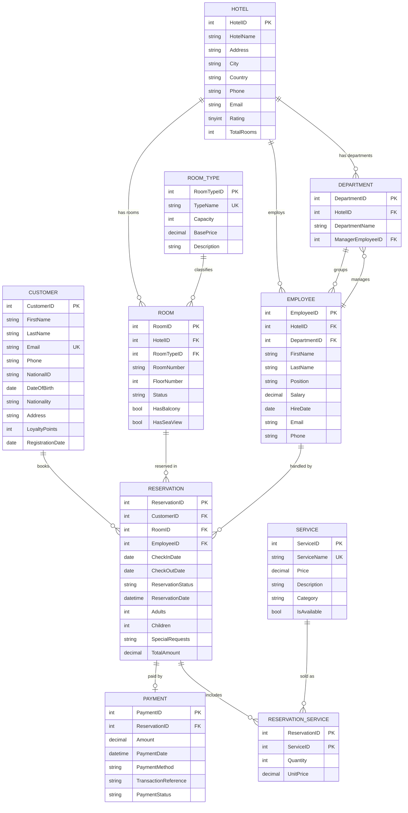
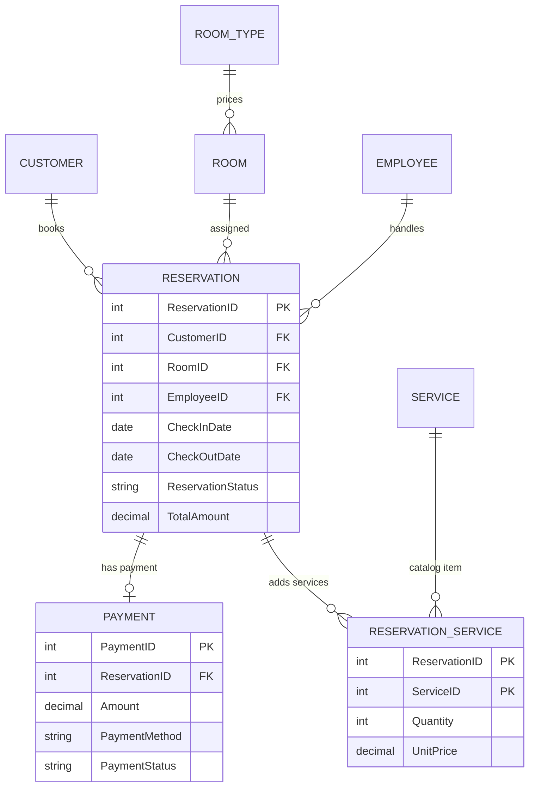

# Database ERD

This document describes the relational model used by the Hotel Reservation Management System. The source of truth is `HotelReservationDbContext` and the domain models under `src/HotelReservation.Domain/Models`.

## High-Level ERD

## Table Summary

| Table | Purpose | Main relationships |
| --- | --- | --- |
| `Hotels` | Physical hotel properties. | One hotel has many rooms, departments, and employees. |
| `RoomTypes` | Room classification and base nightly pricing. | One room type has many rooms. `TypeName` is unique. |
| `Rooms` | Sellable room inventory. | Belongs to one hotel and one room type. `(HotelID, RoomNumber)` is unique. |
| `Customers` | Guests who make reservations. | One customer has many reservations. `Email` is unique. |
| `Departments` | Hotel departments such as front desk or housekeeping. | Belongs to one hotel; optionally points to a manager employee. |
| `Employees` | Staff members who can handle reservations. | Belongs to one hotel; optionally belongs to one department. |
| `Reservations` | Booking records for a room and customer. | Belongs to customer, room, employee; has one optional payment; has many service lines. |
| `Payments` | Payment record for a reservation. | One-to-one with reservation through unique `ReservationID`. |
| `Services` | Extra services such as dining, spa, transport. | Many-to-many with reservations through `ReservationServices`. `ServiceName` is unique. |
| `ReservationServices` | Join table and service-line snapshot. | Composite key `(ReservationID, ServiceID)`; stores quantity and unit price. |

## Key Constraints

| Constraint | Definition | Reason |
| --- | --- | --- |
| `RoomTypes.TypeName` unique | One row per room type name. | Prevents duplicate room categories. |
| `Rooms(HotelID, RoomNumber)` unique | Room numbers are unique within a hotel. | Allows different hotels to reuse room numbers safely. |
| `Customers.Email` unique | One customer record per email address. | Prevents duplicate customer identity by email. |
| `Payments.ReservationID` unique | One payment row per reservation. | Enforces the application rule that a reservation has at most one payment record. |
| `Services.ServiceName` unique | One row per service name. | Prevents duplicate service catalog entries. |
| `ReservationServices(ReservationID, ServiceID)` composite PK | One service line per reservation/service pair. | Prevents attaching the same service twice; quantity captures repeats. |

## Delete Behavior

| Relationship | Delete behavior | Effect |
| --- | --- | --- |
| `Hotel -> Rooms` | Restrict | A hotel cannot be deleted while rooms reference it. |
| `Hotel -> Departments` | Restrict | A hotel cannot be deleted while departments reference it. |
| `Hotel -> Employees` | Restrict | A hotel cannot be deleted while employees reference it. |
| `Department -> Employees` | Set null | Deleting a department keeps employees and clears their department. |
| `Department.ManagerEmployeeID -> Employee` | Set null | Deleting the manager employee clears the manager pointer. |
| `RoomType -> Rooms` | Restrict | A room type cannot be deleted while rooms use it. |
| `Customer -> Reservations` | Restrict | Customers with reservations are retained. |
| `Room -> Reservations` | Restrict | Rooms with reservations are retained. |
| `Employee -> Reservations` | Restrict | Employees who handled reservations are retained. |
| `Reservation -> Payment` | Restrict | A reservation with payment cannot be deleted without handling the payment first. |
| `Reservation -> ReservationServices` | Cascade | Deleting a reservation removes its service lines. |
| `Service -> ReservationServices` | Cascade | Deleting a service removes its reservation service lines. |

## Reservation-Centered Model

`Reservation.TotalAmount` is a stored calculated value. The application calculates it from:

1. room type base price multiplied by stay nights;
2. plus `ReservationServices.Sum(UnitPrice * Quantity)`.

`ReservationService.UnitPrice` snapshots the service price at the time it is attached, so later service catalog price changes do not rewrite historical reservation totals.

## Identity Tables

`HotelReservationDbContext` inherits from `IdentityDbContext<IdentityUser>`, so ASP.NET Identity tables are also created in the same database. They are intentionally omitted from the domain ERD because they support authentication/authorization rather than hotel reservation business data.

Expected Identity tables include the standard ASP.NET Core Identity set, such as:

- `AspNetUsers`
- `AspNetRoles`
- `AspNetUserRoles`
- `AspNetUserClaims`
- `AspNetRoleClaims`
- `AspNetUserLogins`
- `AspNetUserTokens`

## Status Values

The database stores status values as strings. The application centralizes accepted values in `DomainValues`:

| Concept | Values |
| --- | --- |
| Reservation status | `Pending`, `Confirmed`, `Cancelled`, `Completed` |
| Room status | `Available`, `Occupied`, `Maintenance` |
| Payment status | `Paid`, `Pending`, `Partial`, `Refunded` |
| Payment method | `Cash`, `CreditCard`, `DebitCard`, `OnlinePayment`, `BankTransfer` |
