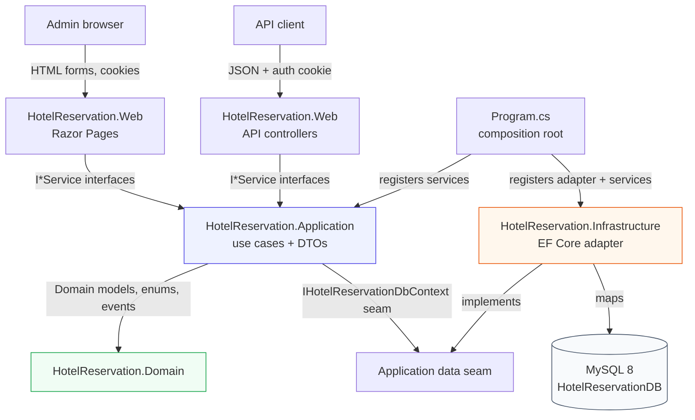
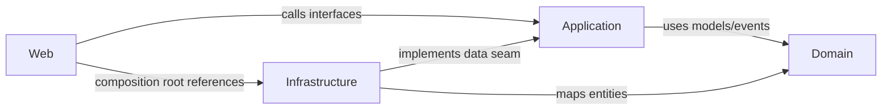
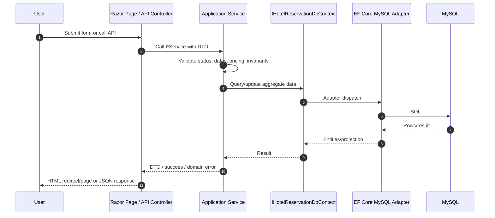
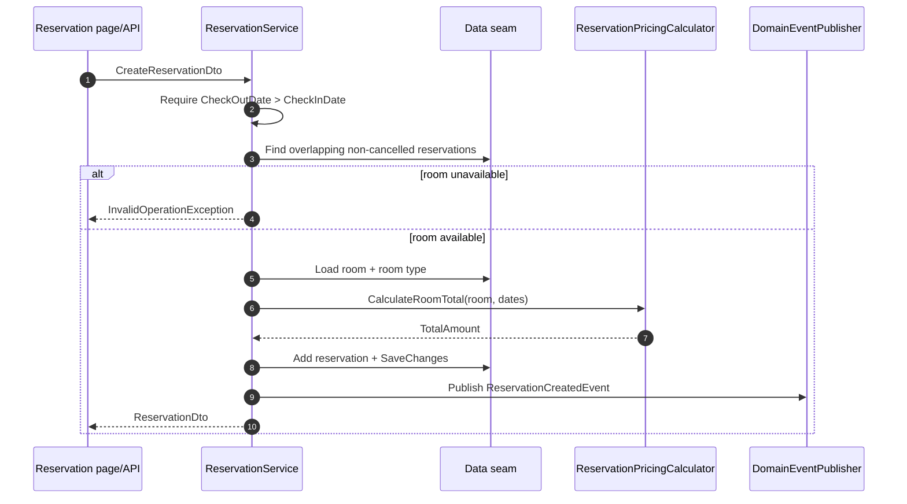
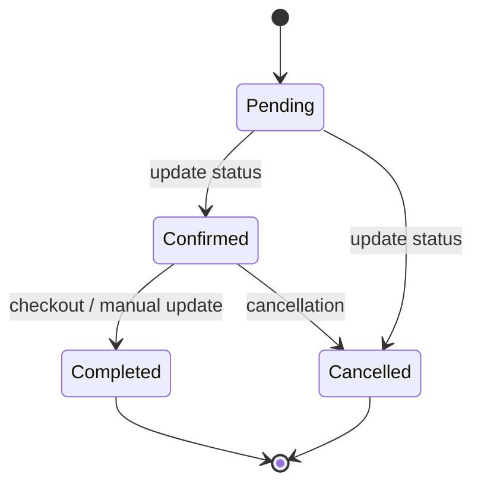
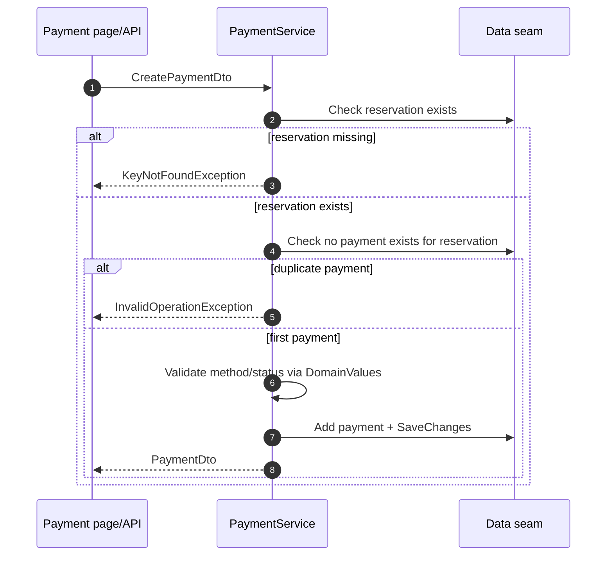
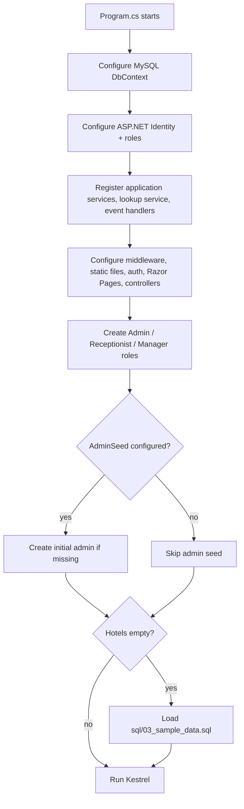

# .NET Architecture and Flow

This document describes the ASP.NET Core side of the Hotel Reservation Management System: the project layout, dependency direction, module interfaces, request flow, and the main reservation/payment workflows.

## Runtime Shape

The app is an ASP.NET Core 8 modular monolith. The Web project hosts both Razor Pages for the admin UI and API controllers for JSON clients. Identity, domain data, migrations, startup seeding, middleware, Swagger, and static assets are composed from `Program.cs`.

## Project Responsibilities

| Project | Responsibility |
| --- | --- |
| `HotelReservation.Domain` | Plain domain entities, enums, and domain event contracts. It has no persistence or web dependency. |
| `HotelReservation.Application` | Use-case services, service interfaces, DTOs, business rules, status constants, pricing calculation, lookup queries, reporting queries, and the `IHotelReservationDbContext` data seam. |
| `HotelReservation.Infrastructure` | EF Core `HotelReservationDbContext`, MySQL mappings, Identity storage, and migrations. It adapts the Application data seam. |
| `HotelReservation.Web` | Razor Pages, API controllers, middleware, layout/assets, authentication setup, Swagger setup, DI composition, startup role/admin/sample-data seeding. |

## Dependency Direction

The important direction is toward the application/domain core:

`Application` does not reference the Infrastructure project directly. Instead, services depend on `IHotelReservationDbContext`. The concrete EF Core adapter is registered in Web:

- `AddDbContext<HotelReservationDbContext>(...)`
- `AddScoped<IHotelReservationDbContext>(sp => sp.GetRequiredService<HotelReservationDbContext>())`
- `AddScoped<IReservationService, ReservationService>()`, and the other application services.

This keeps business workflows testable through service interfaces while still allowing EF Core queries where the app currently needs them.

## Core Modules

| Module | Interface | Main role |
| --- | --- | --- |
| `ReservationService` | `IReservationService` | Validates reservation dates, checks room availability, calculates base room total, persists reservations, and publishes reservation events. |
| `ReservationServiceEntityService` | `IReservationServiceEntityService` | Attaches paid services to reservations, enforces the composite key, snapshots service price, and recomputes totals. |
| `PaymentService` | `IPaymentService` | Enforces one payment per reservation, validates payment method/status, and manages payment records. |
| `RoomService` | `IRoomService` | Manages rooms and availability filtering. |
| `ReportService` | `IReportService` | Builds reservation summary, monthly revenue, and popular service projections. |
| `LookupService` | `ILookupService` | Supplies UI dropdown/search data without Razor Pages querying DbContext directly. |
| `ReservationPricingCalculator` | static module | Calculates room total and full reservation total from room type price, stay dates, and service total. |
| `DomainValues` | static module | Centralizes reservation, room, payment status, and payment method values. |

## Request Flow

## Reservation Flow

Availability uses overlap logic:

- same `RoomID`
- status is not `Cancelled`
- existing `CheckInDate < requested CheckOutDate`
- existing `CheckOutDate > requested CheckInDate`

## Reservation Status Flow

When a reservation transitions to `Confirmed`, `ReservationConfirmedEventHandler` reconciles room status from `Available` to `Occupied` if it is still safe to do so. When it transitions to `Cancelled`, a cancellation event is published for future side effects.

## Payment Flow

## Startup Flow

The initial admin is no longer hard-coded. Configure:

- `AdminSeed:Email`
- `AdminSeed:Password`

For environment variables use:

- `AdminSeed__Email`
- `AdminSeed__Password`

## UI Assets

The admin UI uses Bootstrap 5, Bootstrap Icons, Chart.js, and project-specific `admin.css`/`admin.js`. Vendor assets are stored locally under `wwwroot/lib`, so the UI does not depend on external CDN availability at runtime.
